# Tarea 2 · Entorno móvil e inteligencia artificial con MCP

| | |
|---|---|
| **UEA y clave** | Administración de Proyectos de Software (1151055) |
| **Trimestre** | 26-O, otoño 2026 |
| **Licenciatura** | Ingeniería en Computación |
| **Nombre** | Max Uriel Sánchez Díaz |
| **Matrícula** | 2213026327 |
| **Profesor** | M. en C. Gabriel Hurtado Avilés |
| **Fecha** | 16 de octubre de 2026 |

Universidad Autónoma Metropolitana, Unidad Azcapotzalco · División de Ciencias Básicas e Ingeniería · Departamento de Sistemas

## Contenido

1. [Resumen](#resumen)
2. [Parte 1. El entorno de desarrollo móvil](#parte-1-el-entorno-de-desarrollo-móvil)
3. [Parte 2. MCP: investigación](#parte-2-mcp-investigación)
4. [Parte 3. MCP: implementación](#parte-3-mcp-implementación)
5. [Capturas](#capturas)
6. [Exposición](#exposición)
7. [Conclusiones](#conclusiones)
8. [Uso de inteligencia artificial](#uso-de-inteligencia-artificial)
9. [Referencias](#referencias)

---

## Resumen

Dejé la computadora y mi teléfono listos para la app del proyecto: instalé Flutter, completé el SDK de Android y corrí HolaMundoFlutter y HolaMundoKMP en el teléfono. Después investigué MCP con la especificación 2026-07-28 y dejé funcionando en Claude Desktop el servidor de sistema de archivos, limitado a una carpeta de esta tarea. Como extra, hice un servidor MCP propio en Python.

```text
tarea2/
├── README.md          este documento
├── docs/              la investigación, un archivo por punto
├── config/            la configuración de MCP y un script que la instala
├── img/               capturas
├── presentacion/      diapositivas y guion
└── servidor-propio/   servidor MCP entregas-apsw (opcional)
```

---

## Parte 1. El entorno de desarrollo móvil

Cloné los repositorios del profesor en `C:\dev` y seguí sus README (Hurtado Avilés, 2026a, 2026b).

| Pieza | Versión |
|---|---|
| Sistema operativo | Windows 11 Pro 25H2 (10.0.26200.9711) |
| Android Studio | 2026.2.1 (AI-262.9437.185.2621.16467767) |
| Flutter | 3.47.7, canal stable |
| Dart | 3.13.5 |
| SDK de Android | Platforms 35, 36.1 y 37; Build-Tools 37.0.0; Platform-Tools 37.0.0; Command-line Tools 23.0 |
| Dispositivo | Google Pixel 7 Pro con Android 17 (API 37) |

1. **Command-line Tools.** En Android Studio: *Settings → Languages & Frameworks → Android SDK → SDK Tools*, marqué *Android SDK Command-line Tools* (captura 1).
2. **Flutter.** Lo cloné y agregué `C:\dev\flutter\bin` al `PATH` (captura 2):
   ```powershell
   git clone -b stable https://github.com/flutter/flutter.git C:\dev\flutter
   flutter --version
   ```
3. **flutter doctor.** Acepté las licencias con `flutter doctor --android-licenses` y quedaron en verde Flutter y Android toolchain (captura 3). La advertencia de Visual Studio sólo aplica a apps de escritorio para Windows.
4. **Teléfono.** Activé las opciones para desarrolladores y la depuración por USB, y lo conecté (captura 4). `flutter devices` lo muestra (captura 5). No hay captura de «Acerca del teléfono» porque ahí aparecen el número y el IMEI.
5. **HolaMundoFlutter.** Desde `C:\dev\Flutter-Projects\HolaMundoFlutter` corrí `flutter run -d <id>`. La app muestra el saludo de Android y el contador (captura 6).
6. **HolaMundoKMP.** Lo abrí en Android Studio y lo corrí con la configuración `androidApp` en el teléfono (captura 7). Si `local.properties` se escribe a mano, la ruta del SDK debe ir con `/`: con `\` Gradle falla con *Invalid file path*.

---

## Parte 2. MCP: investigación

| # | Documento |
|---|---|
| 1 | [Evolución de los modelos](docs/01-evolucion-de-los-modelos.md) |
| 2 | [El problema del aislamiento](docs/02-el-problema-del-aislamiento.md) |
| 3 | [MCP frente a una API](docs/03-mcp-frente-a-una-api.md) |
| 4 | [Arquitectura](docs/04-arquitectura.md) |
| 5 | [El servidor de sistema de archivos](docs/05-servidor-de-sistema-de-archivos.md) |
| 6 | [Seguridad](docs/06-seguridad.md) |
| 7 | [Casos de uso](docs/07-casos-de-uso.md) |

**Versión de la especificación:** revisión 2026-07-28, consultada el 15 de octubre de 2026 (Model Context Protocol, 2026b).

### MCP frente a una API

| Aspecto | API | MCP |
|---|---|---|
| Quién decide qué se invoca | El programador, en el código | El modelo, en el momento; el usuario aprueba |
| Cómo se descubren las capacidades | Leyendo la documentación | Preguntándole al servidor (`tools/list`) |
| Acoplamiento | Fuerte | Débil: sólo se conoce el protocolo |
| Formato de los mensajes | El de cada API | JSON-RPC 2.0 |
| Autenticación y consentimiento | Llaves o tokens; nadie aprueba cada llamada | OAuth 2.1 en HTTP; el host pide permiso por herramienta |
| Reutilización | Una integración por aplicación | Un servidor sirve para cualquier host |

MCP no sustituye a las APIs: casi siempre envuelve una.

---

## Parte 3. MCP: implementación

### 1. Cliente

Usé **Claude Desktop** (2.42304, Windows). Ya lo tenía, la guía oficial de MCP lo usa para conectar servidores locales (Model Context Protocol, s. f.-a) y antes de cada herramienta muestra qué va a hacer y pide permiso. Eso último sirve para la demostración.

### 2. Instalación paso a paso

Probado en Windows 11 Pro con Node.js 24.14.0, Python 3.13.4 y Claude Desktop 2.42304.

1. Instalar Node.js y Claude Desktop, clonar este repositorio y crear la carpeta `tarea2\sandbox` con algunos archivos de prueba. Esa carpeta es local y no se sube al repositorio.
2. Cerrar Claude Desktop desde la bandeja (*Salir*). Si se edita la configuración con la app abierta, la reescribe y borra los cambios.
3. Registrar los servidores con `node tarea2\config\instalar-mcp.mjs` (captura 8a). El script calcula las rutas según dónde esté el repositorio y deja un respaldo. También se puede hacer a mano en *Settings → Developer → Edit Config*.
4. Abrir Claude Desktop. En *Servidores MCP locales* deben aparecer los dos servidores **En ejecución** (capturas 8b y 8c). En **+ → Conectores** se ven las 14 herramientas, todas con «Requiere aprobación» (captura 9).

El archivo [`config/claude_desktop_config.json`](config/claude_desktop_config.json) no lleva credenciales:

```json
{
  "mcpServers": {
    "sistema-archivos": {
      "command": "npx",
      "args": [
        "-y",
        "@modelcontextprotocol/server-filesystem@1.0.0",
        "C:\\Users\\maxsa\\Documents\\UAM-A\\administracion_uam_a\\tarea2\\sandbox"
      ]
    },
    "entregas-apsw": {
      "command": "C:\\Users\\maxsa\\Documents\\UAM-A\\administracion_uam_a\\tarea2\\servidor-propio\\.venv\\Scripts\\python.exe",
      "args": [
        "C:\\Users\\maxsa\\Documents\\UAM-A\\administracion_uam_a\\tarea2\\servidor-propio\\servidor.py",
        "C:\\Users\\maxsa\\Documents\\UAM-A\\administracion_uam_a"
      ]
    }
  }
}
```

La versión va fija (`@1.0.0`) y la única carpeta permitida es `tarea2/sandbox/`. Ojo: en el chat de Claude Desktop ése es el límite, pero la pestaña Code manda su propia carpeta (*Roots*) y la reemplaza ([punto 5](docs/05-servidor-de-sistema-de-archivos.md#cómo-lo-limitan-los-directorios-permitidos)). Por eso la demostración se hace en el chat.

### 3. Operaciones

| Lo que pedí en el chat | Herramienta | Captura |
|---|---|---|
| Listar la carpeta permitida | `list_allowed_directories`, `list_directory` | 10 |
| Leer `proyecto/bitacora.md` | `read_text_file` | 11 |
| Crear `proyecto/minuta-2026-10-16.md` | `write_file` | 12a, 12 |
| Marcar dos tareas en `proyecto/pendientes.md` | `edit_file` | 13a, 13 |
| Buscar los `.md` y cuál menciona Gradle | `search_files` y lectura | 14 |

Antes de escribir, Claude Desktop mostró la ruta y el contenido exactos, y elegí *Permitir una vez* (capturas 12a y 13a). En la búsqueda, el modelo primero buscó sin recursión, se dio cuenta de que le faltaba la subcarpeta y repitió con `**/*.md`.

### 4. El límite de seguridad

Le pedí leer `C:\Users\maxsa\Documents\UAM-A\administracion_uam_a\tarea2\README.md`. Respondió que no pudo, porque el servidor rechazó la ruta por estar fuera de `tarea2\sandbox`, y me sugirió copiar el archivo a esa carpeta o pegarle el contenido (captura 15).

Lo impidió el servidor, no el modelo: el modelo sí intentó la llamada, pero el servidor resolvió la ruta, la comparó con la carpeta permitida y respondió:

```text
Access denied - path outside allowed directories: …\tarea2\README.md not in …\tarea2\sandbox
```

### 5. Opcional: servidor propio

[`servidor-propio/servidor.py`](servidor-propio/servidor.py) es **entregas-apsw**, hecho con el SDK oficial de Python, `mcp` 2.3.0 (Model Context Protocol, 2026a, s. f.-c). En la versión 2 del SDK, `FastMCP` se llama `MCPServer` (Model Context Protocol, s. f.-b).

| Herramienta | Qué hace |
|---|---|
| `revisar_entrega(tarea)` | Dice si la carpeta de una tarea tiene lo que pide el enunciado |
| `buscar_credenciales(subcarpeta)` | Busca tokens, llaves o contraseñas antes de hacer push |
| `dias_para_entrega(fecha_limite)` | Calcula cuánto falta o el descuento por retraso |

También publica el recurso `apsw://reglas-entrega`. Las herramientas son de sólo lectura y no salen de la raíz del repositorio. Para probarlo sin Claude Desktop:

```powershell
cd tarea2\servidor-propio
python -m venv .venv
.venv\Scripts\python.exe -m pip install -r requirements.txt
.venv\Scripts\python.exe comprobar.py propio ..\..
```

En Claude Desktop revisó esta tarea y respondió que está completa (captura 16).

---

## Capturas

**1.** SDK Manager con las Command-line Tools

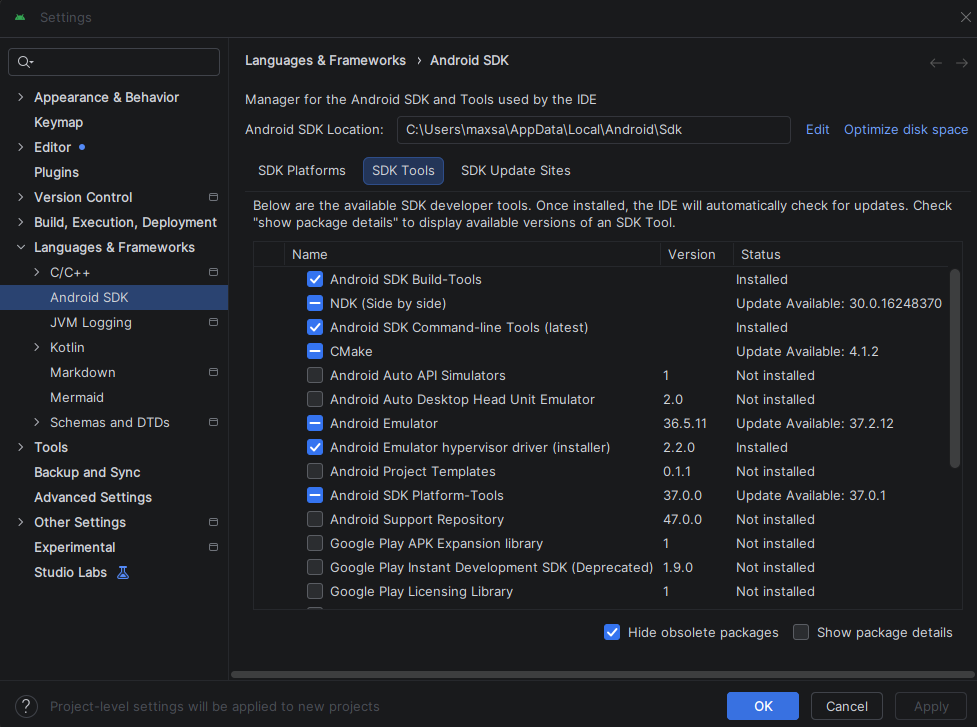

**2.** `flutter --version`

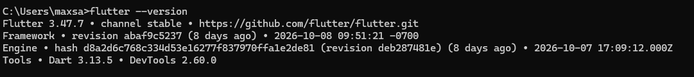

**3.** `flutter doctor`

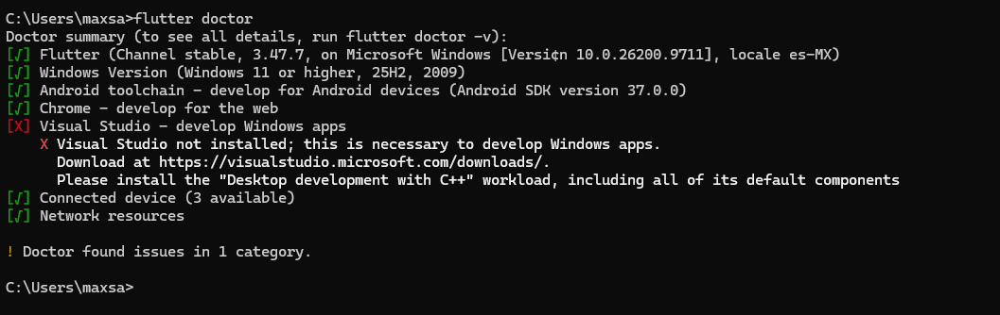

**4.** Depuración por USB activada

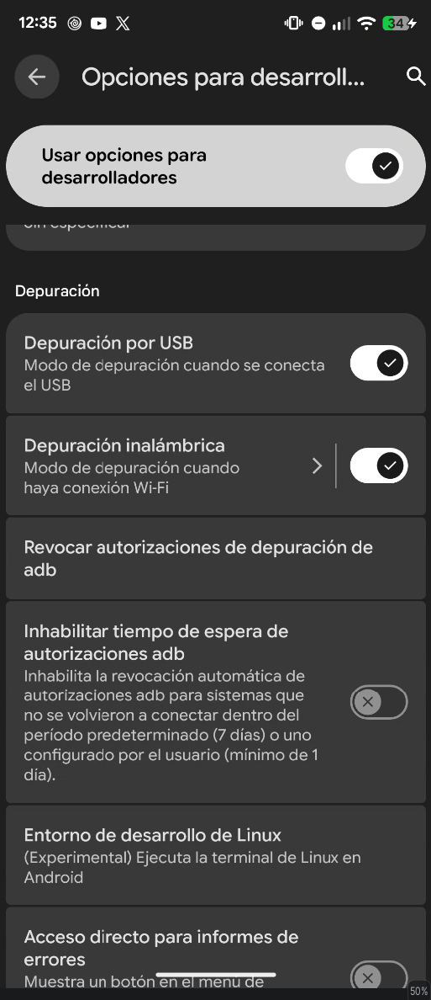

**5.** `flutter devices` con el teléfono

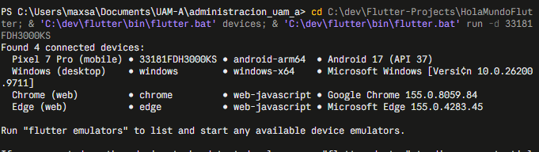

**6.** HolaMundoFlutter en el teléfono

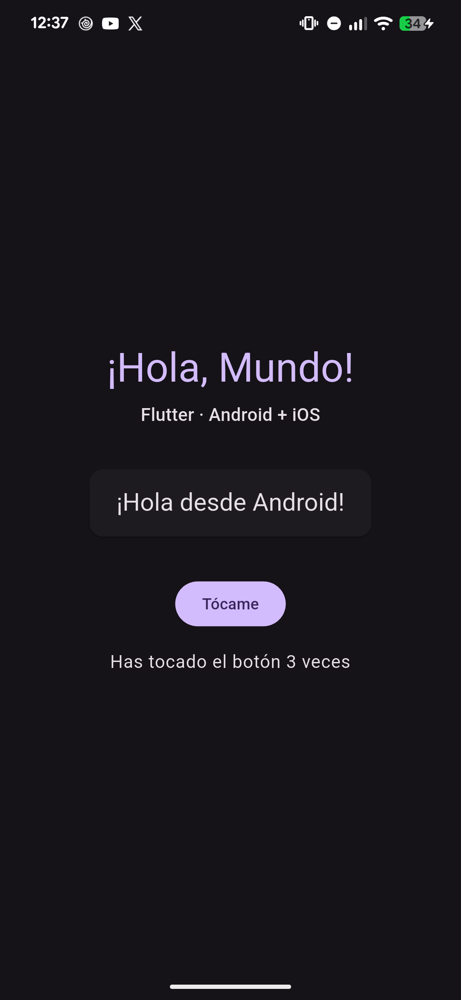

**7.** HolaMundoKMP desde Android Studio

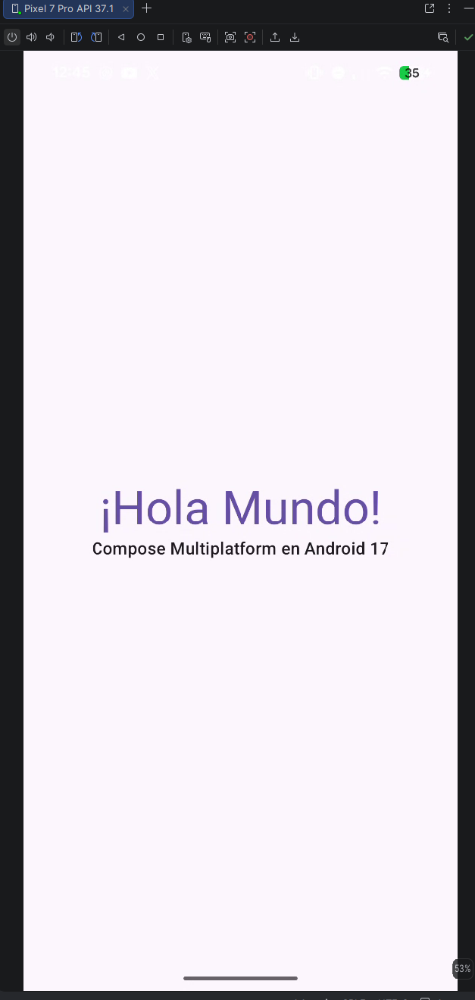

**8a.** El script registra los servidores

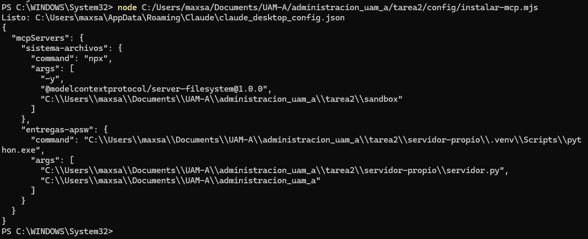

**8b y 8c.** Los dos servidores en ejecución

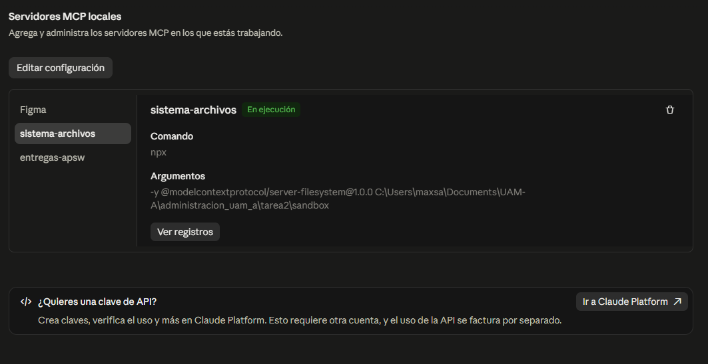

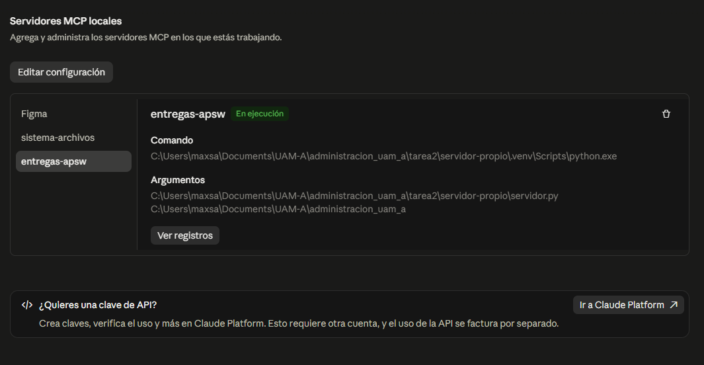

**9.** Las herramientas y sus permisos

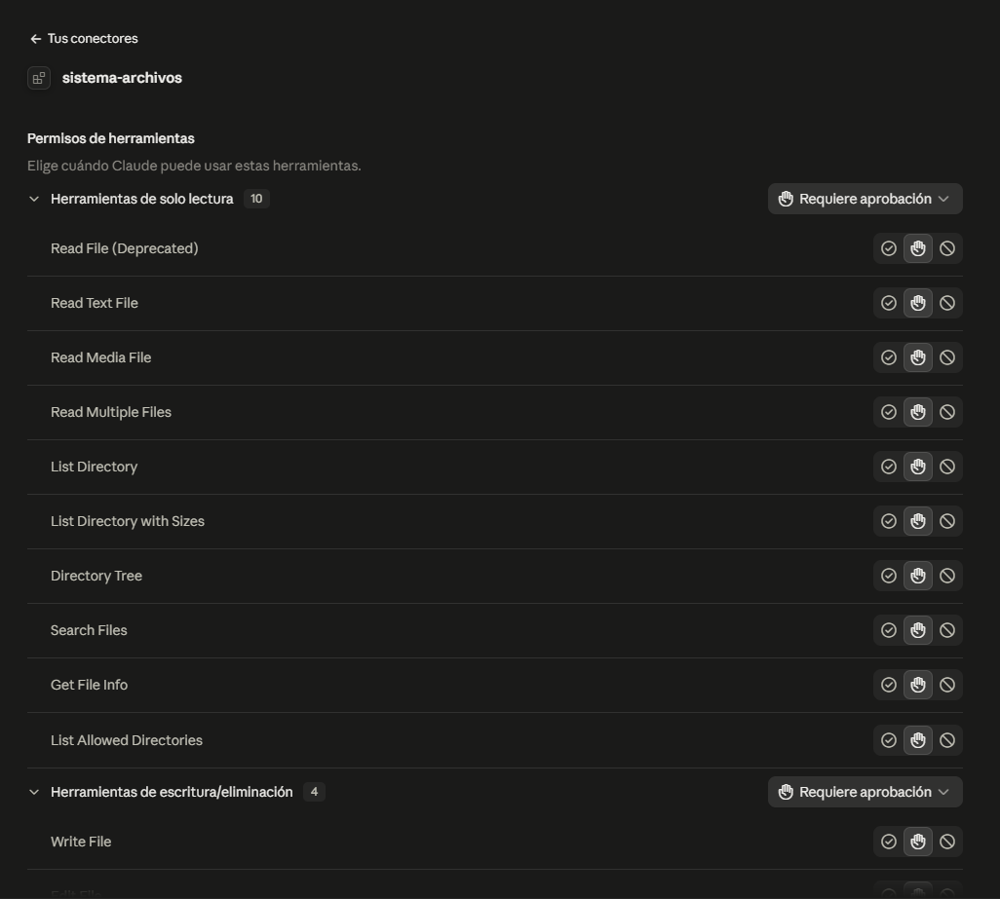

**10.** Listar

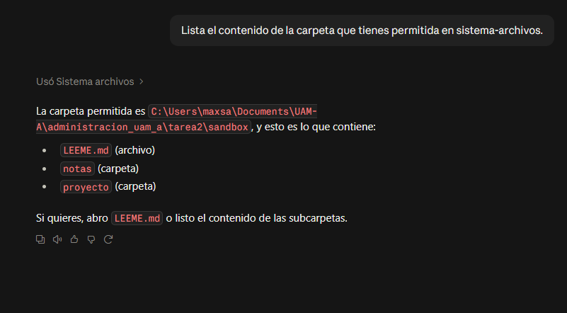

**11.** Leer

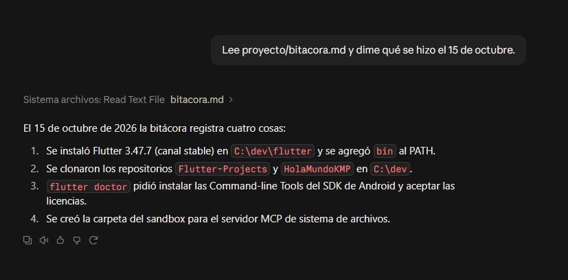

**12a y 12.** Crear

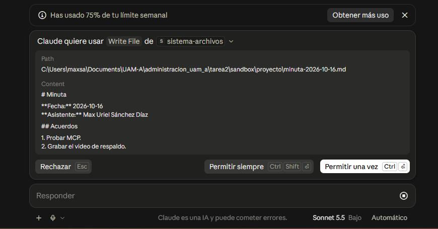

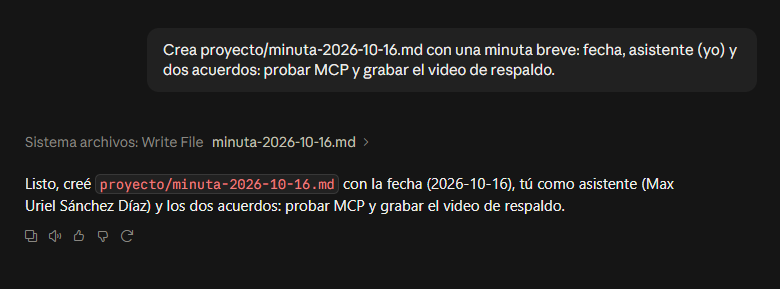

**13a y 13.** Modificar

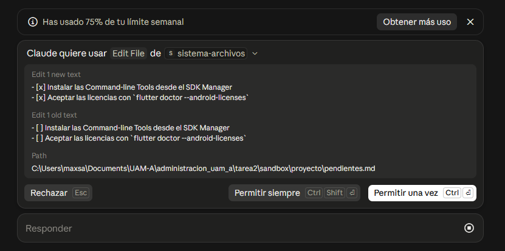

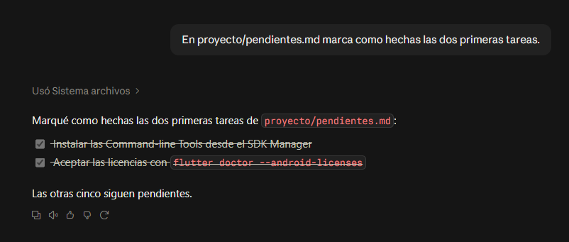

**14.** Buscar

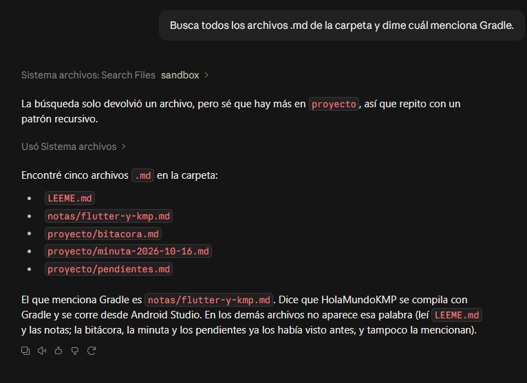

**15.** El límite de seguridad

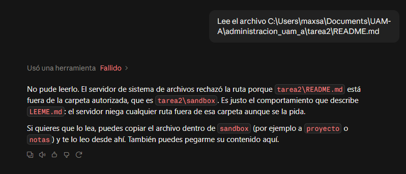

**16.** El servidor propio

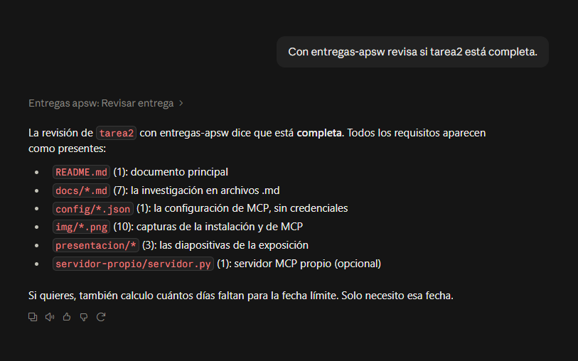

---

## Exposición

Las diapositivas están en [PDF](presentacion/diapositivas.pdf) y en [HTML](presentacion/diapositivas.html); el guion, en [`presentacion/guion.md`](presentacion/guion.md).

- **¿En qué se diferencia MCP de consumir una API?** Con una API, yo decido en el código qué se llama. Con MCP, el servidor publica un catálogo, el modelo decide qué usar en el momento y yo lo apruebo. MCP no reemplaza a la API: la envuelve.
- **¿Qué habilita exactamente el servidor de sistema de archivos?** Listar, leer, buscar por nombre, crear, editar y mover archivos, sólo dentro de la carpeta permitida (o de las raíces que mande el cliente). Fuera de ella rechaza todo.

---

## Conclusiones

El modelo nunca entra a mi computadora. Quien toca los archivos es un programa local, el servidor MCP, que sólo hace un conjunto pequeño de operaciones y sólo en la carpeta que le doy. La diferencia con una API no está en la tecnología, sino en quién decide qué se llama: antes el programador y ahora el modelo, con una persona que aprueba.

El límite de carpetas funcionó, pero depende del código del servidor y del cliente, como mostró la diferencia entre el chat y la pestaña Code. Por eso conviene sumar capas: una carpeta sólo para esto, la versión fija y la confirmación de cada escritura. En la parte móvil, lo que más tiempo tomó fue lo que rodea a Flutter: el componente del SDK que faltaba y las licencias.

---

## Uso de inteligencia artificial

Usé un asistente de IA para buscar fuentes y redactar borradores de `docs/` y de este README, para escribir y probar el servidor propio y los scripts de `config/` y `servidor-propio/`, y para instalar Flutter y compilar las apps desde la terminal. También corrió HolaMundoFlutter en el teléfono y tomó la captura 6 con `adb`. Yo hice la demostración en Claude Desktop, corrí HolaMundoKMP desde Android Studio y tomé las demás capturas.

---

## Referencias

Cada documento de [`docs/`](docs/) tiene sus propias referencias. Las que cito aquí:

Hurtado Avilés, G. (2026a). *HolaMundoFlutter* [Software]. GitHub. https://github.com/gabrielhuav/Flutter-Projects/tree/main/HolaMundoFlutter

Hurtado Avilés, G. (2026b). *HolaMundoKMP* [Software]. GitHub. https://github.com/gabrielhuav/HolaMundoKMP

Model Context Protocol. (2026a, 2 de octubre). *mcp* (Versión 2.3.0) [Software]. PyPI. https://pypi.org/project/mcp/

Model Context Protocol. (2026b, 28 de julio). *Specification* (Revisión 2026-07-28). https://modelcontextprotocol.io/specification/2026-07-28

Model Context Protocol. (s. f.-a). *Connect to local MCP servers*. Recuperado el 15 de octubre de 2026, de https://modelcontextprotocol.io/docs/develop/connect-local-servers

Model Context Protocol. (s. f.-b). *Migration guide* [MCP Python SDK]. Recuperado el 15 de octubre de 2026, de https://py.sdk.modelcontextprotocol.io/migration/

Model Context Protocol. (s. f.-c). *SDKs*. Recuperado el 15 de octubre de 2026, de https://modelcontextprotocol.io/docs/sdk
