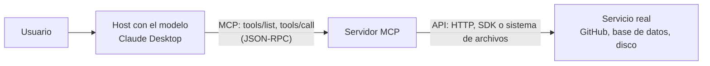

# 3. MCP frente a una API

[← Volver al README](../README.md#parte-2-mcp-investigación)

## Qué es una API

Una API (*application programming interface*) es un contrato entre programas: define qué operaciones existen, qué datos recibe cada una, qué devuelve y qué errores puede dar. En una API web, como las de estilo REST que describió Fielding (2000), cada operación es una URL con un método HTTP. Por ejemplo, la API de GitHub tiene una operación para listar los *issues* de un repositorio.

Lo importante es **quién decide**. Al programar contra una API, yo leo su documentación y escribo en mi código qué operación se llama, con qué parámetros y en qué momento. Si mañana quiero usar otra operación, tengo que cambiar el código y volver a desplegarlo. El programa sólo hace lo que yo dejé escrito.

## Qué es MCP

El Model Context Protocol es un protocolo abierto para que las aplicaciones con LLM se conecten a fuentes de datos y herramientas externas. Anthropic lo presentó el 25 de noviembre de 2024 (Anthropic, 2024) y en diciembre de 2025 lo donó a la Agentic AI Foundation, un fondo de la Linux Foundation que cofundó con Block y OpenAI (Anthropic, 2025; Linux Foundation, 2025). Hoy lo gobierna esa fundación y no una sola empresa. Sus mensajes son de JSON-RPC 2.0 (Model Context Protocol, 2026h), un formato ligero de llamada remota: cada petición lleva un `method`, sus `params` y un `id`, y la respuesta lleva el mismo `id` con un `result` o un `error` (JSON-RPC Working Group, 2013).

Un servidor MCP no se usa programando cada llamada. Publica un **catálogo**: la lista de sus herramientas con su nombre, una descripción en lenguaje natural y el esquema JSON de sus parámetros. La aplicación lo pide con `tools/list`, se lo pasa al modelo y el modelo decide, en ese momento y según lo que le pidió el usuario, cuál usar. La especificación lo dice así: las herramientas están «controladas por el modelo» (Model Context Protocol, 2026i). Cuando el modelo elige una, la aplicación la ejecuta con `tools/call`, pidiendo antes permiso al usuario.

Estos son mensajes reales que intercambié por stdio con el servidor de sistema de archivos de la [Parte 3](../README.md#parte-3-mcp-implementación) (recortados):

```text
--> {"jsonrpc":"2.0","id":2,"method":"tools/list"}
<-- {"jsonrpc":"2.0","id":2,"result":{"tools":[ … {"name":"list_directory",
      "description":"Get a detailed listing of all files and directories in a specified path. …",
      "inputSchema":{"type":"object","properties":{"path":{"type":"string"}},"required":["path"]},
      "annotations":{"readOnlyHint":true,"openWorldHint":false}} … ]}}       ← 14 herramientas

--> {"jsonrpc":"2.0","id":3,"method":"tools/call","params":{"name":"list_directory",
      "arguments":{"path":"C:\\Users\\maxsa\\Documents\\UAM-A\\administracion_uam_a\\tarea2\\sandbox"}}}
<-- {"jsonrpc":"2.0","id":3,"result":{"content":[{"type":"text","text":"[FILE] LEEME.md\n[DIR] notas\n[DIR] proyecto"}]}}
```

La descripción está escrita para que la lea un modelo, no un programador: explica para qué sirve la herramienta y cuándo conviene usarla.

## Tabla comparativa

| Aspecto | API | MCP |
|---|---|---|
| **Quién decide qué se invoca** | El programador, de antemano, en el código. | El modelo, en tiempo de ejecución, entre las herramientas del catálogo; el usuario aprueba. |
| **Cómo se descubren las capacidades** | Leyendo la documentación (por ejemplo, una especificación OpenAPI) antes de programar. | Preguntándole al servidor: `tools/list`, `resources/list`, `prompts/list`. Si cambia el catálogo, el servidor avisa con `notifications/tools/list_changed`. |
| **Acoplamiento** | Fuerte: el cliente conoce cada ruta y parámetro; un cambio en la API rompe el código. | Débil: el cliente sólo conoce el protocolo; se agrega o quita una herramienta sin tocar la aplicación. |
| **Formato de los mensajes** | Lo define cada API: HTTP con JSON, XML, gRPC… Cada una a su manera. | Siempre JSON-RPC 2.0, con los mismos métodos en todos los servidores. |
| **Transporte** | Casi siempre HTTP a un servidor remoto. | stdio (un proceso local) o Streamable HTTP (remoto). |
| **Autenticación y consentimiento** | Llaves o tokens (OAuth, API keys) que el programa manda en cada petición; el usuario final no aprueba cada llamada. | En HTTP se usa OAuth 2.1; en stdio, las credenciales del entorno local. Además, el host debe pedir el consentimiento del usuario antes de invocar una herramienta. |
| **Reutilización entre aplicaciones** | Cada aplicación escribe su propia integración con cada API (N × M). | Un servidor se escribe una vez y lo usa cualquier host compatible: Claude Desktop, VS Code, Cursor, Antigravity… (N + M). |
| **Para quién está escrita la documentación** | Para personas que programan. | Para el modelo: descripciones en lenguaje natural y esquemas. |

## MCP no sustituye a las APIs

MCP no reemplaza a las APIs: casi siempre envuelve una que ya existe. El servidor MCP oficial de GitHub (GitHub, s. f.) es una capa que traduce `tools/call` a llamadas a la API REST de GitHub. El servidor de sistema de archivos que instalé hace lo mismo con la API de archivos de Node.js, que a su vez usa las llamadas del sistema operativo.



La diferencia está en quién está del otro lado. Una API es una interfaz entre programas, pensada para que un programador la use. MCP es una interfaz entre un modelo y esas APIs, pensada para que el modelo descubra qué puede hacer y lo pida en el momento. Sin la API de abajo, el servidor MCP no tendría nada que ofrecer.

## Lo que aporta el video

El video «Diferencia entre API y MCP» (Vida MRR - Programacion web, 2026) explica las API REST como contratos sin estado pensados para humanos y presenta MCP como la capa intermedia entre el host y servicios como GitHub, una base de datos o los archivos. También advierte de la inyección de instrucciones y del envenenamiento de herramientas. Dos cosas suyas se deben contrastar con la especificación:

- Ubica los *prompts* del lado del cliente. En la especificación son una primitiva del **servidor**, que el usuario elige (ver [punto 4](04-arquitectura.md)).
- Describe el *handshake* `initialize` de la versión 2025-11-25. La versión 2026-07-28, publicada 20 días después del video, lo eliminó.

## Referencias

Anthropic. (2024, 25 de noviembre). *Introducing the Model Context Protocol*. https://www.anthropic.com/news/model-context-protocol

Anthropic. (2025, 9 de diciembre). *Donating the Model Context Protocol and establishing the Agentic AI Foundation*. https://www.anthropic.com/news/donating-the-model-context-protocol-and-establishing-of-the-agentic-ai-foundation

Fielding, R. T. (2000). *Architectural styles and the design of network-based software architectures* [Tesis doctoral, University of California, Irvine]. https://ics.uci.edu/~fielding/pubs/dissertation/top.htm

GitHub. (s. f.). *GitHub MCP Server* [Software]. GitHub. Recuperado el 16 de octubre de 2026, de https://github.com/github/github-mcp-server

JSON-RPC Working Group. (2013, 4 de enero). *JSON-RPC 2.0 specification*. https://www.jsonrpc.org/specification

Linux Foundation. (2025, 9 de diciembre). *Linux Foundation announces the formation of the Agentic AI Foundation (AAIF), anchored by new project contributions including Model Context Protocol (MCP), goose and AGENTS.md* [Comunicado de prensa]. https://www.linuxfoundation.org/press/linux-foundation-announces-the-formation-of-the-agentic-ai-foundation

Model Context Protocol. (2026h, 28 de julio). *Specification* (Revisión 2026-07-28). https://modelcontextprotocol.io/specification/2026-07-28

Model Context Protocol. (2026i, 28 de julio). *Tools* (Revisión 2026-07-28). https://modelcontextprotocol.io/specification/2026-07-28/server/tools

Vida MRR - Programacion web. (2026, 8 de julio). *Diferencia entre API y MCP* [Video]. YouTube. https://youtu.be/FdVkE8u2C_Q
