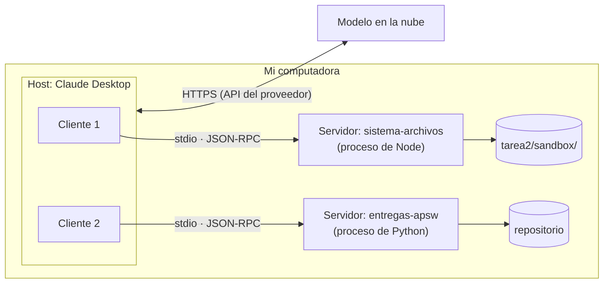

# 4. Arquitectura

[← Volver al README](../README.md#parte-2-mcp-investigación)

> **Versión de la especificación consultada:** revisión **2026-07-28**, la vigente, publicada el 28 de julio de 2026 (Soria Parra & Delimarsky, 2026) y consultada el 15 de octubre de 2026. Para el *handshake* `initialize`, que esa revisión eliminó, consulté también la revisión **2025-11-25**. La especificación cambia seguido: entre esas dos revisiones cambió el ciclo de vida y tres funciones quedaron obsoletas.

## Host, cliente y servidor

La especificación define tres roles que se comunican con mensajes JSON-RPC 2.0 (Model Context Protocol, 2026h):

- **Host:** la aplicación con el LLM que inicia las conexiones. Contiene a los clientes, decide qué información llega al modelo y pide permiso al usuario.
- **Cliente:** el conector que vive dentro del host. Cada cliente mantiene una relación uno a uno con un servidor (Model Context Protocol, 2026a).
- **Servidor:** el programa que ofrece contexto y capacidades, como herramientas o datos.

El modelo no es uno de los roles. El host lo consulta por su propia API, le pasa el catálogo de herramientas y, cuando el modelo pide una, el host la ejecuta a través del cliente correspondiente.

| Rol | En lo que instalé |
|---|---|
| Host | Claude Desktop 2.42304 para Windows |
| Clientes | Dos, creados por Claude Desktop: uno para `sistema-archivos` y otro para `entregas-apsw` |
| Servidores | `secure-filesystem-server` 1.0.0 (Node.js, lanzado con `npx`) y `entregas-apsw` 1.0.0 (Python, SDK `mcp` 2.3.0, mi servidor propio) |
| Modelo (no es rol de MCP) | Claude, que corre en los servidores de Anthropic |



El dibujo muestra la idea central: el modelo sigue lejos, sin canal a mi disco. Quien toca los archivos es un proceso local que yo lancé y que sólo ve la carpeta que le indiqué.

## Primitivas del servidor

| Primitiva | Quién la controla | Qué es | En mis servidores |
|---|---|---|---|
| **Tools** (herramientas) | El modelo | Funciones que el modelo puede pedir que se ejecuten, con un esquema JSON para sus parámetros. | `sistema-archivos` expone 14; `entregas-apsw`, 3. |
| **Resources** (recursos) | La aplicación | Datos identificados por una URI que el host puede leer y agregar al contexto, como un archivo o un registro. | `entregas-apsw` publica `apsw://reglas-entrega`. |
| **Prompts** | El usuario | Plantillas de mensaje que el usuario elige, por ejemplo desde un menú o como comando con `/`. | Ninguno de los dos. |

La columna «quién la controla» es la clave: no es lo mismo una función que el modelo decide llamar que un dato que la aplicación adjunta o una plantilla que el usuario escoge (Model Context Protocol, 2026h). Al arrancar, cada servidor declara qué primitivas tiene. El de archivos sólo declaró herramientas: `"capabilities":{"tools":{"listChanged":true}}`.

## Primitivas del cliente

También el servidor puede pedirle cosas al cliente:

- **Roots** (raíces). El cliente le dice al servidor en qué carpetas (URIs `file://`) puede trabajar. El servidor de sistema de archivos las usa si el cliente las ofrece, y entonces reemplazan a las carpetas que recibió como argumento (Model Context Protocol, 2026d). En la revisión 2026-07-28, Roots quedó **obsoleta** (*deprecated*) y podrá eliminarse en la primera revisión que salga a partir del 28 de julio de 2027 (Model Context Protocol, 2026c). El servidor de referencia todavía la recomienda porque es de la generación anterior del protocolo.
- **Elicitation** (solicitud de datos). El servidor, a mitad de una operación, pide al usuario un dato que le falta o una confirmación. El cliente le muestra al usuario un formulario (definido con un esquema JSON) o una URL, y el usuario puede aceptar, rechazar o cancelar. Es la única función del cliente que la revisión 2026-07-28 deja sin marcar como obsoleta.
- **Sampling**, en revisiones anteriores, dejaba que el servidor pidiera al modelo del cliente que generara texto. También quedó obsoleta en 2026-07-28.

## Transportes

| | stdio | Streamable HTTP |
|---|---|---|
| Dónde corre el servidor | En la misma máquina: el cliente lo lanza como subproceso. | Donde sea: es un servicio web. |
| Cómo viajan los mensajes | Un JSON-RPC por línea en la entrada y la salida estándar del proceso; `stderr` queda para mensajes de registro. | Un solo *endpoint* que recibe POST; la respuesta es JSON o un flujo SSE ligado a esa petición. |
| Autenticación | Las credenciales del entorno local; la especificación dice que no debería usar la autorización de HTTP. | OAuth 2.1 (Model Context Protocol, 2026b). |
| Cuándo se usa | Herramientas locales: archivos, Git, una base de datos en mi máquina. | Servicios compartidos o remotos. |

Los dos servidores que instalé usan stdio (Model Context Protocol, 2026j). Por eso el de archivos escribe su aviso «Secure MCP Filesystem Server running on stdio» en `stderr` y mi servidor manda ahí sus errores: `stdout` es exclusivamente el canal de JSON-RPC. El transporte HTTP+SSE de la primera versión está obsoleto desde 2025-03-26.

## Ciclo de vida: de 2025-11-25 a 2026-07-28

Hasta la revisión 2025-11-25, toda conexión empezaba con un *handshake*: el cliente manda `initialize` con su versión y sus capacidades, el servidor responde con las suyas y el cliente confirma con `notifications/initialized` (Model Context Protocol, 2025a). Así se ve con el servidor de archivos:

```text
--> {"jsonrpc":"2.0","id":1,"method":"initialize","params":{"protocolVersion":"2025-11-25","capabilities":{},
      "clientInfo":{"name":"prueba-manual","version":"1.0"}}}
<-- {"jsonrpc":"2.0","id":1,"result":{"protocolVersion":"2025-11-25","capabilities":{"tools":{"listChanged":true}},
      "serverInfo":{"name":"secure-filesystem-server","version":"1.0.0"}}}
--> {"jsonrpc":"2.0","method":"notifications/initialized"}
```

La revisión 2026-07-28 hizo el protocolo sin estado: ya no hay `initialize` ni identificador de sesión. Cada petición lleva su versión y las capacidades del cliente en `_meta`, y el servidor anuncia lo que ofrece con un método nuevo, `server/discover`. Cuando el servidor necesita algo del usuario a mitad de una petición, ya no le manda una petición propia al cliente: responde con un `InputRequiredResult` y el cliente reintenta con la respuesta (Model Context Protocol, 2026e).

Lo comprobé con mi cliente de prueba (`servidor-propio/comprobar.py`, SDK 2.3.0). Con mi servidor, hecho con el mismo SDK, se negoció la versión **2026-07-28**. Con el servidor de archivos 1.0.0, que según su registro de cambios es la última versión de la generación anterior, se negoció **2025-11-25**. El cliente primero prueba si el servidor habla la versión nueva y, si no, cae al *handshake*. Claude Desktop hace lo mismo: su registro dice `Era probe verdict: legacy` cuando un servidor no responde a la prueba de la versión nueva.

## Referencias

Model Context Protocol. (2025a, 25 de noviembre). *Lifecycle* (Revisión 2025-11-25). https://modelcontextprotocol.io/specification/2025-11-25/basic/lifecycle

Model Context Protocol. (2026a, 28 de julio). *Architecture* (Revisión 2026-07-28). https://modelcontextprotocol.io/specification/2026-07-28/architecture

Model Context Protocol. (2026b, 28 de julio). *Authorization* (Revisión 2026-07-28). https://modelcontextprotocol.io/specification/2026-07-28/basic/authorization

Model Context Protocol. (2026c, 28 de julio). *Deprecated features* (Revisión 2026-07-28). https://modelcontextprotocol.io/specification/2026-07-28/deprecated

Model Context Protocol. (2026d). *Filesystem MCP Server* [Archivo README]. GitHub. Recuperado el 15 de octubre de 2026, de https://github.com/modelcontextprotocol/servers/tree/main/src/filesystem

Model Context Protocol. (2026e, 28 de julio). *Key changes* (Revisión 2026-07-28). https://modelcontextprotocol.io/specification/2026-07-28/changelog

Model Context Protocol. (2026h, 28 de julio). *Specification* (Revisión 2026-07-28). https://modelcontextprotocol.io/specification/2026-07-28

Model Context Protocol. (2026j, 28 de julio). *Transports: Overview* (Revisión 2026-07-28). https://modelcontextprotocol.io/specification/2026-07-28/basic/transports

Soria Parra, D., & Delimarsky, D. (2026, 28 de julio). *The 2026-07-28 specification*. Model Context Protocol Blog. https://blog.modelcontextprotocol.io/posts/2026-07-28/
